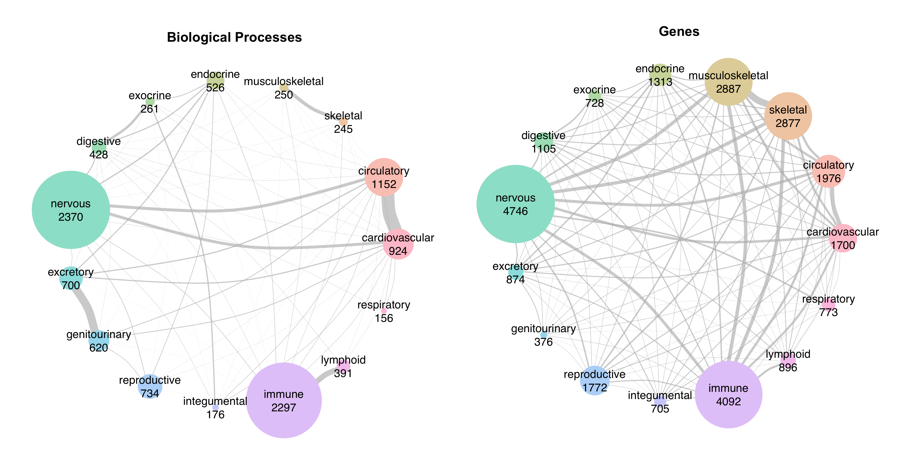

# uberon-go

Welcome to uberon-go, where the anatomy ontology [UBERON](http://uberon.org/) meets the [Gene Ontology](https://www.geneontology.org/) (GO) to programatically download their relations.

An R script is provided to obtain, relative to an anatomy ontology term:
- **descendant anatomic terms** (`descendants.txt`);
- related Gene Ontology (GO) **Biological Process** (BP) terms (`GO_BPs.txt`);
- related **genes** (`genes.txt`).

Manually curated terms **specific for _Homo sapiens_** are further provided:
- Relationships between anatomic terms and GO BPs for selection (`GO_relations.txt`);
- Filtered GO BPs (`GO_BPs_filtered.txt`) and genes (`genes_filtered.txt`);
- Applied filters (`GO-BPs_filter_param.txt`).

The results for 15 anatomical systems are provided. 

_Sharing of the Biological Processes and Genes (human filtered) between the 15 anatomical systems._

Feel free to use the script to perform the analysis on any organ, tissue, cell type, etc., and to apply personalized filters.

## Descendant terms

The term ID can be searched at the Ontology Lookup Service ([OLS](https://www.ebi.ac.uk/ols4/)).   
Children and further descendants from an anatomic ontology term are obtained from OLS through the R package rols.  
The subsets (e.g. human, mouse) that a term belongs to are available for filtering. Please note that this filter was not applied in the analyzed data.
For large families (hundreds of descendants), it may take several minutes to complete the OLS queries.  

Example:
| id      | label      |
| ------------- | ------------- |
|  UBERON:0001016 | nervous system |
| CL:0002319 | neural cell |
| CL:1001602 | cerebral cortex endothelial cell |

## Related GO BPs

For each term of the obtained anatomic descendants, the related GO terms are obtained from OLS through the R package rols.  
The term names, root node (BP/CC/MF) classification, and descendants of the obtained terms are retrieved with the R package GOfuncR.  
For large families (hundreds of descendants), it may take several minutes to complete the OLS queries.  
The parent ID, parent label, descendant ID, descendant label, and distance are provided in individual tables to allow filtering.

Example:
| id      | label     |
| ------------- | ------------- |
| GO:0050877 | nervous system process |
| GO:0007399 | nervous system development |
| GO:0007610| behavior | 

A table with the anatomic terms, related GO terms and relationship between them is available in an optional section (`GO-relations.txt`). This can optionally be used to filter the terms by relationship. 
The filters are applied in the BP results, and the removed terms are available in the (`GO-BPs_filter_param.txt`) files.

## Genes

For each of the obtained BPs, the related genes are obtained from the GO annotations for _Homo sapiens_, through package GOfuncR. Annotations for other organisms can also be used.  
Filtered genes (`genes_filtered.txt`) correspond to all genes related to the filtered BPs (`GO-BPs_filtered.txt`).

## Bibliography

- Mungall, C. J.; Torniai, C.; Gkoutos, G. V.; Lewis, S. E.; Haendel, M. A. Uberon, an Integrative Multi-Species Anatomy Ontology. Genome Biology 2012, 13 (1), R5. https://doi.org/10.1186/gb-2012-13-1-r5.   
- Ashburner et al. Gene ontology: tool for the unification of biology. Nat Genet. 2000 May;25(1):25-9. https://doi.org/10.1038/75556.   
- The Gene Ontology Consortium. The Gene Ontology knowledgebase in 2023. Genetics. 2023 May 4;224(1):iyad031. https://doi.org/10.1093/genetics/iyad031.   
- Gatto L (2024). _rols: An R interface to the Ontology Lookup Service_. <https://doi.org/10.18129/B9.bioc.rols>, R package version 3.0.0, <https://bioconductor.org/packages/rols>.   
- Grote S (2024). _GOfuncR: Gene ontology enrichment using FUNC_. <https://doi.org/10.18129/B9.bioc.GOfuncR>, R package version 1.24.0,  <https://bioconductor.org/packages/GOfuncR>.   
- Wickham H (2023). _stringr: Simple, Consistent Wrappers for Common String Operations_. R package version 1.5.1, <https://CRAN.R-project.org/package=stringr>.   
- Wickham H, François R, Henry L, Müller K, Vaughan D (2023). _dplyr: A Grammar of Data Manipulation_. R package version 1.1.4, <https://CRAN.R-project.org/package=dplyr>.   
